# Cinebridge - Documentação do Microsserviço de Recomendação

## Visão Geral
Este microsserviço é responsável pela orquestração de equipes e recomendação de profissionais para projetos audiovisuais. Ele utiliza algoritmos inteligentes para compor equipes equilibradas baseadas em competências, avaliações e restrições orçamentárias.

## Padrões de Projeto Aplicados

### Existentes
1. **Strategy** — Encapsula algoritmos de recomendação (Similaridade de Cosseno, Filtragem Colaborativa, Regras de Orçamento). Permite trocar o algoritmo em tempo de execução sem alterar o orquestrador.
2. **Template Method** — Define o esqueleto da orquestração de equipes (`OrquestradorEquipe`), permitindo variações na validação e pós-processamento via subclasses.
3. **Observer** — Gerencia notificações (E-mail, Interno, tipo-específico) e auditoria de forma desacoplada do fluxo principal.
4. **Visitor** — Facilita operações transversais como validação de consistência, validação específica por tipo e geração de relatórios sem poluir as classes de domínio.

### Novos (TP2 AV02)
5. **Prototype** — `Projeto` e suas subclasses (`ProjetoDocumentario`, `ProjetoAnimacao`, `ProjetoPublicitario`) implementam `clonar()` para cópia profunda. O `RegistroPrototipos` centraliza o registro de protótipos iniciais e permite criar novos projetos por clonagem, ajustando atributos depois — elimina a necessidade de conhecer detalhes de construção de cada subtipo.

6. **Abstract Factory** — A interface `FabricaProjeto` define 4 métodos (`criarProjeto`, `criarValidador`, `criarRecomendador`, `criarNotificador`). Cada fábrica concreta (`FabricaDocumentario`, `FabricaAnimacao`, `FabricaPublicitario`) garante coerência entre os componentes do mesmo tipo. Adicionar um novo tipo (ex.: realidade virtual) exige apenas uma nova fábrica concreta, sem alterar o orquestrador.

7. **Factory Method** — As subclasses de `Projeto` definem, via `papeisEspecificos()`, quais papéis pertencem ao seu tipo. As fábricas concretas utilizam esse método ao criar o projeto, cumprindo a variação de comportamento por subtipo sem if/switch.

## Onde cada padrão novo foi aplicado e por quê

| Padrão | Onde | Por quê |
|---|---|---|
| Prototype | `src/dominio/Projeto*.ts`, `src/padroes/prototipo/` | Criar projetos derivados de um modelo base sem acoplar o código de criação à estrutura interna de cada subtipo |
| Abstract Factory | `src/padroes/fabrica-abstrata/` | Garantir que validador, recomendador e notificador criados para um tipo de projeto sejam sempre compatíveis entre si |
| Factory Method | `papeisEspecificos()` em subclasses de `Projeto` | Cada subtipo define seus papéis sem que o orquestrador precise de if/switch |

## Diagrama de Classes

```mermaid
classDiagram
    class Projeto {
        +id: string
        +nome: string
        +orcamento: number
        +prazo: Date
        +tipoCaptacao: TipoCaptacao
        +papeisNecessarios: PapelProjeto[]
        +papeisObrigatorios() Papel[]
        +clonar() Projeto
        +aceitar(v: VisitanteProjeto) T
    }

    class ProjetoDocumentario {
        +tematico: boolean
        +clonar() ProjetoDocumentario
        +papeisEspecificos() Papel[]
    }

    class ProjetoAnimacao {
        +taxaRenderizacao: number
        +estilo3D: boolean
        +clonar() ProjetoAnimacao
        +eficienciaRenderizacao() number
        +papeisEspecificos() Papel[]
    }

    class ProjetoPublicitario {
        +prazoRigido: boolean
        +numeroCampanhas: number
        +clonar() ProjetoPublicitario
        +papeisEspecificos() Papel[]
    }

    Projeto <|-- ProjetoDocumentario
    Projeto <|-- ProjetoAnimacao
    Projeto <|-- ProjetoPublicitario

    class RegistroPrototipos {
        -prototipos: Map~string, Projeto~
        +registrar(tipo: string, proto: Projeto) void
        +clonar(tipo: string, ajustes?) Projeto
        +tipos() string[]
    }

    RegistroPrototipos "1" --> "0..*" Projeto : clona

    class FabricaProjeto {
        <<interface>>
        +criarProjeto(dados: DadosProjeto) Projeto
        +criarValidador() VisitanteProjeto~boolean~
        +criarRecomendador() RecomendacaoStrategy
        +criarNotificador() Observador
    }

    class FabricaDocumentario {
        +criarProjeto(dados) ProjetoDocumentario
        +criarValidador() ValidadorDocumentario
        +criarRecomendador() RecomendacaoDocumentario
        +criarNotificador() NotificadorDocumentario
    }

    class FabricaAnimacao {
        +criarProjeto(dados) ProjetoAnimacao
        +criarValidador() ValidadorAnimacao
        +criarRecomendador() RecomendacaoAnimacao
        +criarNotificador() NotificadorAnimacao
    }

    class FabricaPublicitario {
        +criarProjeto(dados) ProjetoPublicitario
        +criarValidador() ValidadorPublicitario
        +criarRecomendador() RecomendacaoPublicitario
        +criarNotificador() NotificadorPublicitario
    }

    FabricaProjeto <|.. FabricaDocumentario
    FabricaProjeto <|.. FabricaAnimacao
    FabricaProjeto <|.. FabricaPublicitario

    class OrquestradorEquipe {
        <<abstract>>
        #fabrica: FabricaProjeto
        +orquestrar(projeto, estrategia, profissionais) Equipe
        #validarRestricoes(projeto) boolean
        #normalizarDados(projeto, profissionais) Profissional[]
        #posProcessar(recomendacoes) Map
    }

    class OrquestradorPadrao {
        +constructor(fabrica?) void
        #validarRestricoes(projeto) boolean
        #normalizarDados(projeto, profissionais) Profissional[]
        #posProcessar(recomendacoes) Map
    }

    OrquestradorEquipe <|-- OrquestradorPadrao
    OrquestradorEquipe "1" o-- "0..1" FabricaProjeto : usa

    class SistemaRecomendacao {
        -estrategiaAtual: RecomendacaoStrategy
        -fabricasPorTipo: Map~TipoCaptacao, FabricaProjeto~
        +definirEstrategia(estrategia) void
        +definirFabrica(fabrica) void
        +registrarFabrica(tipo, fabrica) void
        +executarRecomendacao(projeto, profissionais) Map
        +adicionarObservador(obs) void
    }

    SistemaRecomendacao "1" --> "0..*" FabricaProjeto : registra por tipo

    class RecomendacaoStrategy {
        <<interface>>
        +nome: string
        +recomendar(projeto, profissionais) Map~Papel, Profissional[]~
    }

    class SimilaridadeCosseno { +nome: string }
    class RecomendacaoDocumentario { +nome: string }
    class RecomendacaoAnimacao { +nome: string }
    class RecomendacaoPublicitario { +nome: string }

    RecomendacaoStrategy <|.. SimilaridadeCosseno
    RecomendacaoStrategy <|.. RecomendacaoDocumentario
    RecomendacaoStrategy <|.. RecomendacaoAnimacao
    RecomendacaoStrategy <|.. RecomendacaoPublicitario

    class Observador {
        <<interface>>
        +atualizar(evento: EventoRecomendacao) void
    }

    class NotificadorEmail { +atualizar(evento) void }
    class NotificadorInterno { +atualizar(evento) void }
    class NotificadorDocumentario { +atualizar(evento) void }
    class NotificadorAnimacao { +atualizar(evento) void }
    class NotificadorPublicitario { +atualizar(evento) void }

    Observador <|.. NotificadorEmail
    Observador <|.. NotificadorInterno
    Observador <|.. NotificadorDocumentario
    Observador <|.. NotificadorAnimacao
    Observador <|.. NotificadorPublicitario

    class VisitanteProjeto~T~ {
        <<interface>>
        +visitarProjeto(projeto) T
        +visitarProfissional(profissional) T
    }

    class ValidadorConsistencia { }
    class ValidadorDocumentario { }
    class ValidadorAnimacao { }
    class ValidadorPublicitario { }
    class GeradorRelatorio { }
    class GeradorRelatorioAnimacao { }

    VisitanteProjeto <|.. ValidadorConsistencia
    VisitanteProjeto <|.. ValidadorDocumentario
    VisitanteProjeto <|.. ValidadorAnimacao
    VisitanteProjeto <|.. ValidadorPublicitario
    VisitanteProjeto <|.. GeradorRelatorio
    VisitanteProjeto <|.. GeradorRelatorioAnimacao
```



## Arquitetura
- **Linguagem**: TypeScript strict (Node.js ESM)
- **Framework HTTP**: Fastify
- **ORM**: Prisma (MySQL)
- **Testes**: Vitest
- **Comunicação**: EventEmitter (preparado para expansão para mensageria externa)

## Como Executar

### Pré-requisitos (Windows e Ubuntu)
- Node.js LTS (v20 ou superior)
- npm (incluído no Node.js)

### Instalar dependências
```bash
npm ci
```

### Rodar os testes
```bash
npm test
```

### Rodar os testes em modo watch
```bash
npx vitest
```

### Iniciar o servidor de desenvolvimento
```bash
npm run dev
```

> Os comandos acima funcionam identicamente no Windows 10+ (PowerShell ou CMD) e no Ubuntu 24.04+.
> Não há caminhos fixos nem dependências nativas. O projeto usa apenas módulos npm multiplataforma.

## Requisitos Atendidos
- Baixa latência (< 2s para recomendações).
- Tolerância a falhas via padrão Fallback nos repositórios.
- Logs estruturados para auditoria.
- API escalável para múltiplos produtores.
- Extensível: adicionar novo tipo de projeto exige apenas nova fábrica concreta, sem alterar orquestrador.
