# Cinebridge - Microsserviço de Recomendação e Orquestração

O **Cinebridge** é o coração inteligente da plataforma de gestão audiovisual, desenvolvido para interpretar especificações técnicas de projetos e compor automaticamente equipes equilibradas através de algoritmos de recomendação.

Este repositório contém o microsserviço completo, implementado com foco em padrões de projeto clássicos, tipagem estrita e resiliência de dados. Nesta segunda atividade (TP2 AV02) o sistema foi refatorado para suportar **diferentes tipos de projeto** (documentário, animação e publicitário) usando os padrões **Prototype, Factory Method e Abstract Factory**.

## 🚀 Tecnologias

- **Runtime**: Node.js 20+ (LTS)
- **Linguagem**: TypeScript (Strict Mode, ESM)
- **Framework HTTP**: Fastify
- **ORM**: Prisma
- **Banco de Dados**: MySQL
- **Testes**: Vitest
- **Comunicação interna**: EventEmitter (preparado para expansão para mensageria externa)

## 💻 Compatibilidade

O sistema roda em **Windows 10 ou superior**, **Ubuntu 24.04.03 ou superior** e distribuições derivadas do Ubuntu. Não há caminhos fixos nem dependências nativas: só módulos npm multiplataforma e a API `node:crypto` do próprio Node.js. Os comandos npm são os mesmos nos dois sistemas.

## 🏗️ Arquitetura e Padrões de Projeto

A arquitetura interna segue os princípios de Inversão de Dependência e Separação de Camadas, com a aplicação consciente de sete padrões de projeto.

### Padrões da atividade 1

1. **Strategy**: Encapsula os algoritmos de recomendação (`SimilaridadeCosseno`, `FiltragemColaborativa`, `RegrasOrcamento` e um recomendador para cada tipo de projeto), permitindo trocar o motor de recomendação.
2. **Template Method**: Padroniza o esqueleto da orquestração de equipes em `OrquestradorEquipe`, deixando validação de restrições, normalização e pós-processamento como etapas que as subclasses definem.
3. **Observer**: Gerencia eventos e notificações (e-mail, auditoria, notificador interno e um notificador para cada tipo de projeto).
4. **Visitor**: Facilita operações transversais sobre as entidades de domínio, como validações de consistência (`ValidadorConsistencia` e um validador para cada tipo) e geração de relatórios (`GeradorRelatorio`).

### Padrões da atividade 2 (TP2 AV02)

5. **Prototype**: `Projeto` e suas subclasses (`ProjetoDocumentario`, `ProjetoAnimacao`, `ProjetoPublicitario`) implementam `clonar()` com cópia profunda: papéis, prazo, equipe e os atributos específicos de cada tipo (como a lista de entrevistados do documentário). O `RegistroPrototipos` guarda os protótipos iniciais e cria novos projetos por clonagem, sempre com um novo `id`, status `CRIADO` e sem equipe. Ele aceita ajustes nos atributos e recusa alterar `tipoCaptacao`, `status` e `equipe`.
6. **Factory Method**: `Projeto` declara o método `criarFabrica()`, e cada subclasse decide qual fábrica concreta devolve (`ProjetoAnimacao` devolve `FabricaAnimacao`, e assim por diante). O tipo do projeto define sozinho a família de objetos dele, sem `if`/`switch`. Um `Projeto` genérico, sem fábrica, lança um erro claro.
7. **Abstract Factory**: a interface `FabricaProjeto` define `criarProjeto`, `criarValidador`, `criarRecomendador` e `criarNotificador`. Cada fábrica concreta (`FabricaDocumentario`, `FabricaAnimacao`, `FabricaPublicitario`) garante que os objetos do mesmo tipo trabalhem juntos.

### Onde cada padrão novo foi aplicado e por quê

| Padrão | Onde | Por quê |
|---|---|---|
| Prototype | `src/dominio/Projeto*.ts`, `src/padroes/prototipo/` | Criar projetos a partir de um modelo pré-configurado, sem duplicar a lógica de criação de cada tipo |
| Factory Method | `criarFabrica()` em `Projeto` e subclasses | Cada tipo de projeto escolhe a sua própria fábrica |
| Abstract Factory | `src/padroes/fabrica-abstrata/` | Garantir que validador, recomendador e notificador de um tipo de projeto sejam sempre compatíveis entre si |

### Como o orquestrador usa a fábrica

- `OrquestradorEquipe` recebe obrigatoriamente uma `FabricaProjeto` no construtor e não tem nenhum `if`/`switch` por tipo de projeto.
- O **recomendador** vem da fábrica, a menos que uma estratégia seja passada como terceiro parâmetro de `orquestrar(projeto, profissionais, estrategia?)`.
- O **validador** da fábrica confere a consistência da equipe formada. Só se ele aprovar o projeto vai para `EQUIPE_FORMADA`; caso contrário fica em `EM_RECOMENDACAO`.
- O **notificador** da fábrica é avisado ao final da orquestração.
- `SistemaRecomendacao` pergunta ao próprio projeto qual é a sua fábrica (`projeto.criarFabrica()`) e a usa em `executarRecomendacao` (recomenda e notifica) e em `formarEquipe` (monta o orquestrador com a fábrica do tipo).

### Como adicionar um novo tipo de projeto (ex.: realidade virtual)

1. Criar a subclasse de `Projeto` (por exemplo, `ProjetoRealidadeVirtual`) com o método `criarFabrica()`.
2. Criar a fábrica concreta implementando `FabricaProjeto`, com o seu validador, recomendador e notificador.
3. Pronto: `OrquestradorEquipe`, `OrquestradorPadrao` e `SistemaRecomendacao` não precisam de nenhuma alteração. Há um teste automatizado que prova isso (`tests/padroes-criacionais.spec.ts`).

## 🧭 Diagrama de Classes

```mermaid
classDiagram
    class Projeto {
        +id: string
        +nome: string
        +orcamento: number
        +prazo: Date
        +tipoCaptacao: TipoCaptacao
        +papeisNecessarios: PapelProjeto[]
        +papeisObrigatorios() Papel[]
        +criarFabrica() FabricaProjeto
        +clonar() Projeto
        +aceitar(v: VisitanteProjeto) T
    }

    class ProjetoDocumentario {
        +tema: string
        +entrevistados: string[]
        +criarFabrica() FabricaProjeto
        +clonar() ProjetoDocumentario
        +papeisEspecificos() Papel[]
    }

    class ProjetoAnimacao {
        +taxaRenderizacao: number
        +estilo3D: boolean
        +criarFabrica() FabricaProjeto
        +clonar() ProjetoAnimacao
        +eficienciaRenderizacao() number
        +papeisEspecificos() Papel[]
    }

    class ProjetoPublicitario {
        +prazoRigido: boolean
        +numeroCampanhas: number
        +criarFabrica() FabricaProjeto
        +clonar() ProjetoPublicitario
        +papeisEspecificos() Papel[]
    }

    Projeto <|-- ProjetoDocumentario
    Projeto <|-- ProjetoAnimacao
    Projeto <|-- ProjetoPublicitario

    class RegistroPrototipos {
        -prototipos: Map~string, Projeto~
        +registrar(tipo: string, proto: Projeto) void
        +clonar(tipo: string, ajustes?) Projeto
        +tipos() string[]
    }

    RegistroPrototipos "1" --> "0..*" Projeto : clona

    class FabricaProjeto {
        <<interface>>
        +criarProjeto(dados: DadosProjeto) Projeto
        +criarValidador() VisitanteProjeto~boolean~
        +criarRecomendador() RecomendacaoStrategy
        +criarNotificador() Observador
    }

    class FabricaDocumentario {
        +criarProjeto(dados) ProjetoDocumentario
        +criarValidador() ValidadorDocumentario
        +criarRecomendador() RecomendacaoDocumentario
        +criarNotificador() NotificadorDocumentario
    }

    class FabricaAnimacao {
        +criarProjeto(dados) ProjetoAnimacao
        +criarValidador() ValidadorAnimacao
        +criarRecomendador() RecomendacaoAnimacao
        +criarNotificador() NotificadorAnimacao
    }

    class FabricaPublicitario {
        +criarProjeto(dados) ProjetoPublicitario
        +criarValidador() ValidadorPublicitario
        +criarRecomendador() RecomendacaoPublicitario
        +criarNotificador() NotificadorPublicitario
    }

    FabricaProjeto <|.. FabricaDocumentario
    FabricaProjeto <|.. FabricaAnimacao
    FabricaProjeto <|.. FabricaPublicitario

    class OrquestradorEquipe {
        <<abstract>>
        #fabrica: FabricaProjeto
        +orquestrar(projeto, profissionais, estrategia?) Equipe
        #validarRestricoes(projeto) boolean
        #normalizarDados(projeto, profissionais) Profissional[]
        #posProcessar(recomendacoes) Map
    }

    class OrquestradorPadrao {
        +constructor(fabrica) void
        #validarRestricoes(projeto) boolean
        #normalizarDados(projeto, profissionais) Profissional[]
        #posProcessar(recomendacoes) Map
    }

    OrquestradorEquipe <|-- OrquestradorPadrao
    OrquestradorEquipe "1" --> "1" FabricaProjeto : depende
    Projeto "1" ..> "1" FabricaProjeto : cria a sua fabrica

    class SistemaRecomendacao {
        +executarRecomendacao(projeto, profissionais) Map
        +formarEquipe(projeto, profissionais) Equipe
        +adicionarObservador(obs) void
        +removerObservador(obs) void
    }

    SistemaRecomendacao ..> FabricaProjeto : usa a fabrica do projeto

    class RecomendacaoStrategy {
        <<interface>>
        +nome: string
        +recomendar(projeto, profissionais) Map~Papel, Profissional[]~
    }

    class SimilaridadeCosseno { +nome: string }
    class RecomendacaoDocumentario { +nome: string }
    class RecomendacaoAnimacao { +nome: string }
    class RecomendacaoPublicitario { +nome: string }

    RecomendacaoStrategy <|.. SimilaridadeCosseno
    RecomendacaoStrategy <|.. RecomendacaoDocumentario
    RecomendacaoStrategy <|.. RecomendacaoAnimacao
    RecomendacaoStrategy <|.. RecomendacaoPublicitario

    class Observador {
        <<interface>>
        +atualizar(evento: EventoRecomendacao) void
    }

    class NotificadorEmail { +atualizar(evento) void }
    class NotificadorInterno { +atualizar(evento) void }
    class NotificadorDocumentario { +atualizar(evento) void }
    class NotificadorAnimacao { +atualizar(evento) void }
    class NotificadorPublicitario { +atualizar(evento) void }

    Observador <|.. NotificadorEmail
    Observador <|.. NotificadorInterno
    Observador <|.. NotificadorDocumentario
    Observador <|.. NotificadorAnimacao
    Observador <|.. NotificadorPublicitario

    class VisitanteProjeto~T~ {
        <<interface>>
        +visitarProjeto(projeto) T
        +visitarProfissional(profissional) T
    }

    class ValidadorConsistencia { }
    class ValidadorDocumentario { }
    class ValidadorAnimacao { }
    class ValidadorPublicitario { }
    class GeradorRelatorio { }
    class GeradorRelatorioAnimacao { }

    VisitanteProjeto <|.. ValidadorConsistencia
    VisitanteProjeto <|.. ValidadorDocumentario
    VisitanteProjeto <|.. ValidadorAnimacao
    VisitanteProjeto <|.. ValidadorPublicitario
    VisitanteProjeto <|.. GeradorRelatorio
    VisitanteProjeto <|.. GeradorRelatorioAnimacao
```



## 🛠️ Como Instalar e Rodar

### 1. Clonar o Repositório
```bash
git clone https://github.com/Tierzitto/TP2_AV02.git
cd TP2_AV02
```

### 2. Instalar Dependências
```bash
npm install
```

### 3. Configurar o Ambiente e Banco de Dados
- Copie o arquivo `.env.example` para `.env`:
  - Linux/Ubuntu ou PowerShell:
    ```bash
    cp .env.example .env
    ```
  - Prompt de Comando (CMD) do Windows:
    ```bat
    copy .env.example .env
    ```
- Edite o arquivo `.env` ajustando as credenciais de conexão com o seu banco de dados MySQL (`DATABASE_URL`).
- Gere o Prisma Client:
  ```bash
  npm run prisma:generate
  ```
- Execute as migrações do Prisma para criar o esquema no banco de dados:
  ```bash
  npm run prisma:migrate
  ```

### 4. Executar o Projeto

- **Modo Desenvolvimento (com hot-reload via `tsx`)**:
  ```bash
  npm run dev
  ```
- **Compilação**:
  ```bash
  npm run build
  ```
- **Iniciar**:
  ```bash
  npm start
  ```

## 📦 Scripts Disponíveis

| Script | Descrição |
|---|---|
| `npm run dev` | Inicia o servidor em modo de desenvolvimento com hot-reload |
| `npm run build` | Compila o código TypeScript |
| `npm start` | Inicia a aplicação |
| `npm test` | Executa os testes automatizados com Vitest |
| `npm run test:watch` | Executa os testes em modo watch |
| `npm run prisma:generate` | Gera o Prisma Client com base no schema |
| `npm run prisma:migrate` | Executa migrações do banco de dados em desenvolvimento |

## 📂 Estrutura do Repositório

```text
├── src/
│   ├── dominio/                    # Entidades: Projeto (e subclasses por tipo), Profissional, Equipe...
│   ├── http/                       # Rotas Fastify
│   ├── padroes/
│   │   ├── estrategia/             # Strategy: algoritmos de recomendação
│   │   ├── template-method/        # Template Method: OrquestradorEquipe e OrquestradorPadrao
│   │   ├── observador/             # Observer: notificadores e auditoria
│   │   ├── visitante/              # Visitor: validadores e relatórios
│   │   ├── prototipo/              # Prototype: RegistroPrototipos
│   │   └── fabrica-abstrata/       # Abstract Factory: FabricaProjeto e fábricas por tipo
│   ├── repositorio/                # Persistência (Prisma, Memória e Fallback)
│   └── servicos/                   # SistemaRecomendacao
├── tests/                          # Testes automatizados (Vitest)
├── docs/                           # Notas de arquitetura da atividade 1
└── prisma/                         # Schema e migrações do banco de dados
```

## 📖 Manual da API e Fluxos Principais

### `POST /projetos/:id/recomendar`

Recebe os dados do projeto no corpo, escolhe a fábrica pelo `tipoCaptacao` (`DOCUMENTARIO`, `ANIMACAO` ou `PUBLICITARIO`), monta a equipe e devolve o resultado.

Exemplo de requisição:

```json
{
  "nome": "Curta sobre a Amazônia",
  "genero": "Documentário",
  "duracao": 20,
  "orcamento": 100000,
  "prazo": "2027-03-01T00:00:00.000Z",
  "tipoCaptacao": "DOCUMENTARIO",
  "localizacao": "Sao Paulo",
  "papeisNecessarios": [
    { "papel": "DIRETOR", "peso": 1, "obrigatorio": true }
  ]
}
```

Exemplo de resposta (200):

```json
{
  "projetoId": "abc",
  "status": "EQUIPE_FORMADA",
  "membros": [{ "papel": "DIRETOR", "profissionalId": "prof-1" }]
}
```

| Código | Quando acontece |
|---|---|
| 200 | Equipe processada. O campo `status` mostra `EQUIPE_FORMADA` ou `EM_RECOMENDACAO` |
| 400 | `tipoCaptacao` sem fábrica (por exemplo `FICCAO`) |
| 422 | Projeto não atende às restrições mínimas (orçamento zerado, prazo vencido ou sem papéis obrigatórios) |

### Outros fluxos

- **Tolerância a Falhas**: o sistema conta com `RepositorioProfissionaisFallback`, que assegura o funcionamento contínuo mesmo na indisponibilidade temporária do banco relacional principal.
- **Auditoria**: eventos de recomendação e alteração de equipes disparam notificações monitoradas por observadores.

## 🧪 Executando Testes

```bash
npm test
```

Para acompanhar os testes interativamente:
```bash
npm run test:watch
```

Os testes ficam em `tests/` e cobrem:

- **Prototype**: cópia profunda (papéis, prazo, entrevistados e equipe) e o `RegistroPrototipos`.
- **Factory Method e Abstract Factory**: cada projeto cria a fábrica certa, e cada fábrica cria uma família coerente de objetos.
- **Troca de fábrica**: mostra que recomendação, validação e notificação mudam conforme o tipo do projeto.
- **Extensibilidade**: um tipo novo (realidade virtual) funciona sem alterar o orquestrador.
- **Rota HTTP**: respostas 200, 400 e 422.

---
Desenvolvido com excelência técnica para a orquestração e gestão de talentos na indústria audiovisual.
